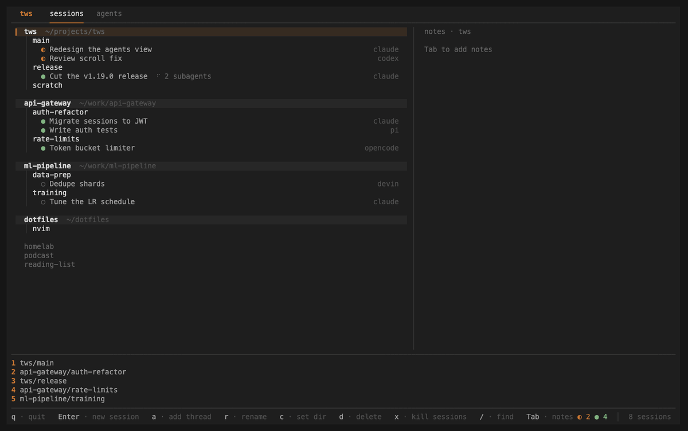
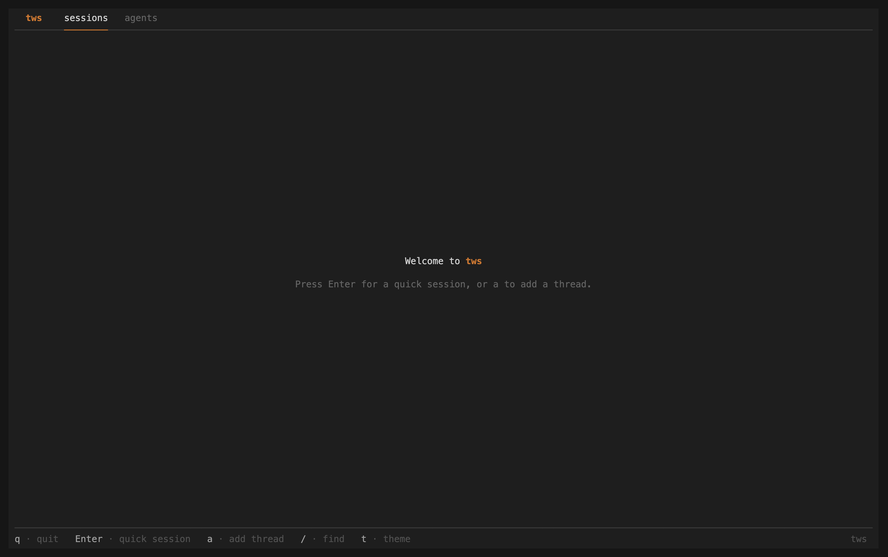
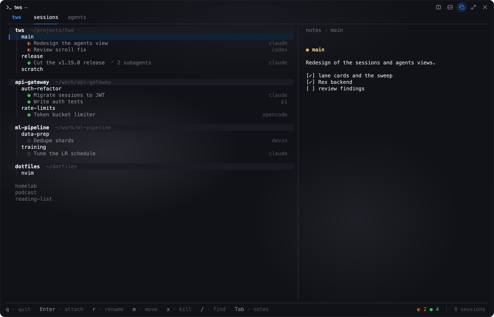
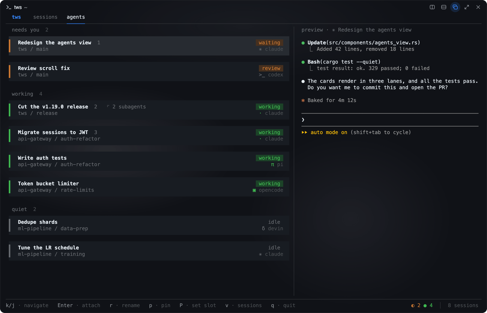

# tws

**terminal workspace manager** — organize your terminal sessions into threads. Works with [Rex](https://www.superlogical.com/rex/) and [tmux](https://github.com/tmux/tmux).



tws is a terminal UI that adds a persistent organizational layer on top of your terminal. It runs on one of two backends: [Rex](https://www.superlogical.com/rex/) (the default) or [tmux](https://github.com/tmux/tmux). Terminal sessions are flat and ephemeral; tws groups them into **threads** you control, and launches and opens them for you.

- **Threads** — units of work (e.g. `auth-refactor`, `bug-1234`, `scratch`), each holding one or more sessions
- **Sessions** — live terminal sessions (a Rex window or a tmux session), launched and opened from tws

Threads are saved to `~/.config/tws/`. Sessions are real Rex windows or tmux sessions that tws finds at runtime. With Rex, tws stays open in its own tab, or opens as a popup with **Cmd+S**. With tmux, detach from a session to go back to tws. See [Backends](#backends).



## Features

### Thread tree

The main view. The thread/session tree on the left, a notes panel on the right. Threads expand to show their sessions, and each running session reveals any AI coding agents detected inside it. Press `Enter` on a thread to spawn a new session, or on a session to attach.



### Thread working directories

A thread can have a default working directory. Sessions launched from it start
there; threads without one start in your home directory.

Press `c` on a thread to open the directory picker. The top row is always the
directory you are browsing — `Enter` there accepts it. Type to filter, `Tab` to
enter the first match, or move down to a subdirectory and press `Enter` to go
into it. `Backspace` deletes a filter character, or goes up a level when the
filter is empty. `Esc` cancels. New threads prompt for a directory right after
you name them.

To point a thread back at your home directory, `Backspace` up to `~` and press
`Enter`.

If a thread's directory is deleted, sessions still launch — they start in your
home directory with a warning in the status bar (tmux's status line, if tws
is running inside tmux).

### Agents view

Toggle with `v`. A flat view of every AI coding agent (Claude Code, Codex, Pi, Devin CLI, OpenCode) running across all your sessions, regardless of which thread owns them. Each agent is a card with its status and harness, in three lanes: needs you, working, and quiet. A card that starts to need you gets a short sweep of light. Press `r` to rename an agent. Pin frequently-used agents to numbered slots — `p` to pin, `P` to set a slot, `0`–`9` to jump to a pinned agent from anywhere.



### Session fork (experimental)

This feature works with the tmux backend only.

Press `prefix+F` in a Claude Code pane to open a **forked** copy of that
session in a new pane on the right. The fork inherits the whole conversation.
It writes to a new session id. The parent transcript stays untouched.

Ask a throwaway question while the parent stays visible. Press `prefix+z` to
zoom the fork, and press it again to restore the split. Type `/exit` to close
the fork pane.

`install.sh` adds the hooks and this binding. It does not overwrite a `prefix+F`
that you already use:

    bind-key F run-shell "tmux split-window -h -l 45% -t #{pane_id} \"tws fork-pane #{pane_id}\""

This feature works with Claude Code only. Codex, Pi, Devin and OpenCode panes do not support
forking. `codex resume` appends to the parent session instead of forking it.

### Read a pane by moving into it

This feature works with the tmux backend only.

An agent pane in the review state means that the agent finished and you did not
look yet. When you attach through tws, tws clears the state. When you move into
the pane with plain tmux, tws cannot see the move. The tmux hooks below close
that gap. They call `tws ack-pane` for the pane you land on. The command clears
the review state of that pane and changes nothing else.

`install.sh` adds the hooks together with the agent status hooks. It writes them
to your tmux config (`~/.tmux.conf`, or `~/.config/tmux/tmux.conf` when that is
the file you use). If you have no tmux config, it creates `~/.tmux.conf`. It also
loads the hooks into a tmux server that is running, so you do not need to reload.
The hooks use the absolute path of the binary, because `run-shell` does not read
your shell `PATH`:

    # tws ack hooks
    set-hook -g after-select-pane[89] 'run-shell -b "/home/you/.local/bin/tws ack-pane #{pane_id}"'
    set-hook -g after-select-window[89] 'run-shell -b "/home/you/.local/bin/tws ack-pane #{pane_id}"'
    set-hook -g client-session-changed[89] 'run-shell -b "/home/you/.local/bin/tws ack-pane #{pane_id}"'
    set-hook -g window-pane-changed[89] 'run-shell -b "/home/you/.local/bin/tws ack-pane #{pane_id}"'
    set-hook -g session-window-changed[89] 'run-shell -b "/home/you/.local/bin/tws ack-pane #{pane_id}"'

To add them by hand, write the full path of your own binary. Do not use `~`. The
path must not contain a space or one of these characters: `'` `"` `\` `$` `#` `;`.
tmux splits the hook line with its own quoting, and a bad path breaks the line.
`install.sh` does not write the hooks for such a path. It prints them instead.

The last two hooks cover `last-pane`, `kill-pane` and `kill-window`. These
commands move focus but fire none of the first three hooks. One move can fire
two hooks. This is safe, because `ack-pane` does the same thing each time.
`kill-session` fires no hook, so a client that falls to another session does
not clear the review state.

The fixed index `89` makes a reload replace the tws entry, and it leaves your own
hooks at other indexes alone.

### Status bar

This feature works with the tmux backend only.

The tmux status bar can show your agents, so you do not need to open tws to see
them. Each window tab shows one glyph for each agent in that window: a green `●`
working, an orange `●` waiting or review, a grey `○` idle. The right end shows the thread and the session.

     0 claude ●   1 zsh   2 review ●○                         tws › status-bar

`install.sh` adds the block below together with the agent status hooks. A config
that sets a status option, or a theme plugin that sets one, has a bar of its own.
For such a config, the installer asks you first. If you say yes, the block goes
after your lines and replaces your bar. If you say no, the installer changes
nothing and shows a note. The installer leaves out the
`status-interval` and `status-right-length` lines when your config sets them.

With [tmux-nova](https://github.com/o0th/tmux-nova), the installer keeps your
nova bar and adds the agents on top of it. It appends the glyph command to your
`@nova-pane`, adds a `tws` segment at the right end, and runs nova again.

When your `@nova-segments-0-right` has segments other than `tws`, the installer
shows your right-side lines and asks if tws can replace them:

- **Yes:** the right side shows only `tws`, and `status-right-length` becomes
  at least 80: a smaller value of yours goes up to 80, a larger one stays. The
  installer first copies to `~/.config/tws/backups/` the tmux config it writes
  and each config that holds your right-side lines. It prints each backup path
  and the `cp` command that restores it. A later run of the installer remembers the
  yes: it asks nothing and makes no new backup.
- **No** (the default, also with no terminal): the `tws` segment goes after your
  segments, and your `status-right-length` stays.

The block after a "no":

    # tws status bar
    set -g status-interval 5  # tws status bar
    set -g status-right-length 80  # tws status bar
    set -ga @nova-pane '#(/home/you/.local/bin/tws bar window --since #{start_time} #{P:#{pane_id} })'  # tws status bar
    set -ga @nova-segments-0-right ' tws'  # tws status bar
    set -g @nova-segment-tws '#(/home/you/.local/bin/tws bar where -- #{q:session_name})'  # tws status bar
    set -g @nova-segment-tws-colors '#c88e68 #121212'  # tws status bar
    set -g @nova-status-style-active-bg '#c88e68'  # tws status bar
    run-shell '/home/you/.tmux/plugins/tmux-nova/nova.tmux'  # tws status bar

After a "yes", the right-side line is
`set -g @nova-segments-0-right 'tws'  # tws status bar replace`. A later run
reads this marker to remember the yes.
When your config does not set `@nova-pane` or `@nova-segments-0-right`, the
block sets them to the nova default plus the tws part. nova does not set
`status-interval` or `status-right-length`, so the block sets them too, except
when your config sets them. The current tab gets the tws color only when your
config does not set `@nova-status-style-active-bg`. For any other bar, the
installer uses the block below.

    # tws status bar
    set -g status-interval 5  # tws status bar
    set -g status-right-length 80  # tws status bar
    set -g status-style 'bg=#1e1e1e,fg=#d4d4d4'  # tws status bar
    set -g status-left ' '  # tws status bar
    set -g window-status-format ' #I #W#{s/[*-]//:window_flags}#(/home/you/.local/bin/tws bar window --since #{start_time} #{P:#{pane_id} }) '  # tws status bar
    set -g window-status-current-format '#[bg=#c88e68,fg=#121212] #I #W#{s/[*-]//:window_flags}#(/home/you/.local/bin/tws bar window --since #{start_time} #{P:#{pane_id} }) #[default]'  # tws status bar
    set -g status-right '#[bg=#c88e68,fg=#121212] #(/home/you/.local/bin/tws bar where -- #{q:session_name}) '  # tws status bar

To use your own bar, add the two commands to it. tmux replaces
`#{P:#{pane_id} }` with the panes of the window, and `tws bar window` prints
their glyphs in the tws theme colors. The current tab gets slightly darker
tones, because it most often has a bright background. `--since #{start_time}`
skips the status files from before the tmux server started. Put the command at
the end of the tab label: the glyph color stays on for the text after it.
`tws bar where` prints `thread › session`. For example, with
[tmux-nova](https://github.com/o0th/tmux-nova):

    set -g @nova-pane '#I#{?pane_in_mode,  #{pane_mode},}  #W#(/home/you/.local/bin/tws bar window --since #{start_time} #{P:#{pane_id} })'
    set -g @nova-segment-tws '#(/home/you/.local/bin/tws bar where -- #{q:session_name})'
    set -g @nova-segment-tws-colors '#c88e68 #121212'
    set -g @nova-segments-0-right 'tws'
    set -g @nova-status-style-active-bg '#c88e68'
    set -g status-interval 5
    set -g status-right-length 80

A `#()` command does not read your shell `PATH`, so write the full path of your
own binary. tmux runs the commands again once in each `status-interval`, so a new
agent state can take up to 5 seconds to show.

To remove the bar, delete the lines that end with `# tws status bar` from your
tmux config, then restart tmux. To keep `install.sh` from adding the bar again,
add this line to your tmux config:

    # tws status bar off

### Notes

Each thread and session has its own markdown note, stored as a plain `.md` file under `~/.config/tws/notes/`. Press `Tab` to focus the notes panel, `Enter` to open the current note in `$EDITOR`. Renders with [glow](https://github.com/charmbracelet/glow) if installed, falls back to basic markdown otherwise. Handy for per-workstream scratch notes, todo lists, and command snippets.

### Fuzzy finder

Press `/` to search across all active sessions by name or path, sorted by most-recently-attached. Type to filter, `Enter` to attach. Works from any view.

### Recent sessions

Keys `1`–`5` attach to the five most-recently-attached sessions instantly — useful for hopping between two or three active workstreams without leaving the keyboard home row. This feature works with the tmux backend only, because Rex does not record when you last opened a window.

### Agent detection

tws scans the panes of each session periodically and identifies running AI coding agents by their child process names — no manual registration. Agents appear automatically under their session in the tree. The optional install-time hooks make tws refresh immediately when an agent starts or stops, instead of waiting for the next scan. When the optional hooks are installed, tws also shows each agent's live status — working, waiting for you, finished and awaiting review, or idle — as a colored bar and status chip in the agents view (`v`), with a count of working/waiting agents in the status bar. A pane that goes silent for 15 minutes while claiming to work is treated as no longer working and drops to idle, so an interrupted or crashed agent does not stay marked active forever.

### Importing existing sessions

Already have tmux sessions running? `tws import` walks you through assigning them to threads, so that they show in the tree. This command works with the tmux backend only. To copy tmux sessions into Rex, see [Copy tmux sessions into Rex](#copy-tmux-sessions-into-rex).

## Requirements

- **[Rex](https://www.superlogical.com/rex/)** or **[tmux](https://github.com/tmux/tmux)** — one is required. Rex is the default. To use tmux, see [Backends](#backends).
- **[glow](https://github.com/charmbracelet/glow)** — optional, for rich markdown rendering in the notes panel. Falls back to basic rendering if absent.

## Install

### Install script (macOS / Linux, x86_64 / ARM)

```sh
curl -fsSL https://raw.githubusercontent.com/ytaskiran/tws/main/install.sh | bash
```

Downloads the latest release binary to `~/.local/bin`. Then it asks which backend
you use: `rex`, `tmux`, or `both`. It sets up only what that backend needs: Rex
gets the key that opens tws, and tmux gets the agent status hooks and the tmux
pieces. The default is the backend in `config.toml`, else the one that is
installed. A piped install with no terminal takes the default, or the answer in
`TWS_BACKEND`, for example `curl ... | TWS_BACKEND=tmux bash`. Then the script
scans your setup and shows all the changes it can make in one list. It asks one main
question, `Apply these changes? [Y/n]`. Before it, the installer can ask about
your own tmux status bar (see [Status bar](#status-bar)). The list can hold:

- agent status hooks for each agent it finds: Claude Code (`~/.claude/settings.json`), Codex (`~/.codex/hooks.json` and `config.toml`; it also asks to turn off `daemon_auto_start`, because hooks in the shared Codex daemon cannot tell which pane they belong to. After a yes, restart your open Codex TUIs and run `codex app-server daemon stop`), Pi (`~/.pi/agent/extensions/`), Devin CLI (the `hooks` key of `~/.config/devin/config.json`; it keeps your other keys and hooks. It makes the file if it is missing. jq cannot keep comments, so a file with comments loses them, and the installer first copies it to `config.json.tws-bak`). Devin CLI also runs the hooks in `~/.claude/settings.json`, so the tws Claude hooks do nothing under Devin and the Devin hooks report the pane, and OpenCode (`~/.config/opencode/plugins/`). Only the OpenCode TUI reports status. `opencode run`, `opencode serve` and `opencode attach` panes show no status. `opencode serve`, `opencode web`, `opencode acp` and the other tool subcommands do not show as agents,
- the tmux ack hooks and the `prefix+F` fork binding in your tmux config (`~/.tmux.conf`, or `~/.config/tmux/tmux.conf`). It creates `~/.tmux.conf` if you have no tmux config, and loads the new lines into a running tmux server. It does not overwrite a `prefix+F` that you already use. Your config can load other files or plugins. If no tmux server runs, the installer cannot see their keys. It then skips the fork binding and asks you to start tmux and run install again,
- a `PATH` line for `~/.local/bin` in your shell rc and profile, if your shell does not find it,
- `glow`, with `brew` or `go`, if it is missing.

Answer `n` to install only the binary. A run with no terminal to answer from
(for example in CI) also changes nothing else.

Re-run the same command any time to upgrade. A re-run replaces the tws lines in place, so it adds no copies.

### Default tmux config (optional)

Before the plan, the script offers the full tmux setup of the tws author:
[`extras/tmux.conf`](extras/tmux.conf). It has TPM, tmux-sensible,
tmux-resurrect, the tmux-nova theme with the tws segments, mouse, clipboard,
and keys. It needs `git`, and the theme needs a [Nerd Font](https://www.nerdfonts.com/).
It downloads the 4 plugins from GitHub, and tmux runs them at each start.

> **Warning:** this option replaces your tmux config. The default answer is no.

If you answer `y`, the script first clones the plugins to `~/.tmux/plugins`.
If TPM does not install, it stops and changes nothing. Then it moves each tmux
config you have (`~/.tmux.conf`, `$XDG_CONFIG_HOME/tmux/tmux.conf`,
`~/.config/tmux/tmux.conf`) to `<file>.tws-backup-<time>`, and writes the new
`~/.tmux.conf`. If a move fails, it moves the configs back. A config in a
symlinked directory (for example, a GNU stow fold) stops the step, so your
dotfiles repo does not change.

The new config loads when tmux starts again. To go back:

1. Remove the new `~/.tmux.conf`. tmux loads each config that exists, so it must go.
2. Move each `<file>.tws-backup-<time>` back to `<file>`.
3. Restart tmux.

### Build from source

Requires a [Rust toolchain](https://rustup.rs/).

```sh
git clone https://github.com/ytaskiran/tws
cd tws
cargo install --path .
```

### macOS Gatekeeper

Release binaries are ad-hoc signed, not notarized. If macOS blocks the binary, clear the quarantine attribute:

```sh
xattr -dr com.apple.quarantine ~/.local/bin/tws
```

## Usage

```sh
tws          # launch the TUI
tws import   # interactively import existing unmanaged tmux sessions
tws ack-pane [PANE_ID]   # mark a pane as read (used by the tmux hooks)
```

The status bar shows context-aware key hints for whatever is selected. The essentials:

### Navigate

| Key | Action |
|---|---|
| `j` / `k` (or `↓` / `↑`) | Move down / up |
| `h` / `l` (or `←` / `→`) | Collapse / expand |
| `Space` | Toggle expand |
| `e` | Toggle expand all |
| `1`–`5` | Attach to a recent session |
| `/` | Fuzzy-find and attach to any session |
| `t` | Pick a theme with a live preview |
| `v` | Toggle agents view |
| `Tab` | Focus the notes panel |
| `q` | Quit |

The mouse works in both views: point at a row to select it, and click a session or agent to open it. Click `sessions` or `agents` at the top to switch the view. The wheel moves the selection in every list. To select text with the mouse, hold `Shift` (`Option` in iTerm2) while you drag.

### Organize

| Key | Action |
|---|---|
| `a` | Add a thread |
| `r` | Rename selected item |
| `d` | Delete selected thread |
| `m` | Move a session to another thread |
| `c` | Set the selected thread's working directory |

### Sessions

| Key | Action |
|---|---|
| `Enter` | Attach to a session, or create a new one on a thread |
| `x` | Kill the selected session (or a thread's sessions) |

With Rex, tws stays open in its own tab: go back to that tab, or press **Cmd+S** to open tws as a popup. With tmux, detach with `prefix + d` to return to tws.

## Backends

tws can use [Rex](https://www.superlogical.com/rex/) or tmux. Rex is the default. To use tmux, run `install.sh` and answer `tmux`, or add this line at the top of `~/.config/tws/config.toml`:

```toml
backend = "tmux"
```

The `TWS_BACKEND` environment variable (`rex` or `tmux`) overrides the config for one run.

### Rex

- A thread is a Rex session. The session label is the thread slug.
- A tws session is a window (tab) in that Rex session. The window label is the session label.
- Extra shells are splits in that tab.

tws shows every Rex session whose label is the same as a thread slug, also a session that you made in Rex. tws ignores a session or a window that has `_` in its label. Two windows in one thread cannot have the same label.

To open a session, tws tells the Rex app to show the window. tws does not exit. Turn on **Remote Control** in the Rex settings (under Rex Server), or the app does not accept this request. When the app refuses, tws shows the error from Rex in the status bar.

Agent status comes from the program status that the agent sends to Rex (OSC 7501). Claude Code sends it. tws shows `working` as working, `blocked` as waiting, `done` and `error` as review, and other states as idle. An agent that sends no program status shows no status.

These features work only with tmux:

- `tws import`, `tws fork-pane`, the tmux status bar, and `tws ack-pane`.
- The recent sessions bar. Rex does not record when you last opened a window.
- A move of a session to a different thread. Rex cannot move a window to a different session.

Rex keeps `done` until the agent reports again, and it does not tell tws what you look at. So tws clears the review when you open the agent, or the session that lands on it, from tws, and it saves that in `~/.config/tws/rex-seen`. When you go to the agent in Rex directly, the review stays until you open it from tws or the agent reports again.

### Open tws with a key

Press **Cmd+S** in Rex to open tws as a popup over the tab you are in. Pick a session, and Rex shows it and the popup closes. Press `q` to close the popup without a pick. tws keeps its cursor between popups. If tws already runs in a tab, for example one where you started it yourself, the key goes to that tab and does not start a second tws. The key works when Remote Control is off.

`install.sh` puts the action in `~/.config/tws/tws.lua` and adds one `pcall(dofile, ...)` line to your Rex `init.lua` after you confirm. An install writes `tws.lua` again, so set a different key in `init.lua`. Add these lines after the `pcall(dofile, ...)` line, then run `rex config reload`:

```lua
rex.unbind("cmd+s", "tws_open")
rex.bind("<your key>", "tws_open")
```

### Copy tmux sessions into Rex

Run `extras/rex/tmux2rex.py` on the machine that runs tmux. It does a dry run and shows the `rex` commands. Add `--apply` to create the Rex sessions on the Rex server of that machine. The script restarts each Claude Code pane with `claude --resume ID --fork-session`, so your tmux sessions do not change.

## Configuration

Optional. Drop a TOML file at `~/.config/tws/config.toml` to customize the backend, theme, palette, and keybindings. A missing or empty file keeps tws's defaults — everything below is opt-in.

### Theme

Press `t` to open the theme picker. Move the cursor to preview each theme on the whole UI. `Enter` saves the theme as the `theme` line in `config.toml`, and `Esc` goes back to the theme you had.

Or set a preset by hand:

```toml
theme = "catppuccin-mocha"
```

Available presets: `default`, `merino-dark`, `merino-light`, `catppuccin-mocha`, `catppuccin-macchiato`, `catppuccin-frappe`, `catppuccin-latte`, `gruvbox-dark`, `gruvbox-light`, `nord`, `tokyo-night`.

`merino-dark` and `merino-light` use the colors of Rex's default themes, so tws matches the Rex window around it.

You can also drop a custom theme file at `~/.config/tws/themes/<name>.toml` and reference it by name. Custom themes use the same `[palette]` schema as below.

### Glass

Set `glass = true` to let tws draw no background of its own. The terminal background then shows through, so tws keeps the translucent look of the Rex Glass interface style. Selection and card tints stay opaque, because a terminal cell has no transparency.

Put `glass` with `theme` at the top of `config.toml`, above any `[table]` header. Below a header, TOML reads it as a key of that table, and tws ignores it. Use the theme that matches your Rex theme, for example `merino-dark` with Merino Dark. tws mixes its tints and text colors for the theme `bg`, so a theme that does not match the window can be hard to read.

```toml
theme = "merino-dark"
glass = true

[palette]
# ...
```

### Palette overrides

Override any subset of the 8 palette colors on top of the chosen theme:

```toml
[palette]
accent = "#ff9e64"   # primary accent (threads, highlights)
green  = "#a6e3a1"   # sessions, success states
fg     = "#d4d4d4"   # foreground text
dim    = "#a0a0a0"   # secondary text
muted  = "#646464"   # tertiary / disabled
border = "#3c3c3c"   # borders, separators
bg     = "#1e1e1e"   # background
waiting = "#cc7832"  # waiting and review agents (default: accent)
```

### Keybindings

Rebind any action by mode. Only specify what you want to change; unspecified actions keep their defaults.

```toml
[keys.normal]
quit       = "q"
add        = "a"
move_down  = "ctrl+j"
move_up    = "ctrl+k"
finder     = "/"
theme_picker = "t"

[keys.agents]
toggle_view = "v"

[keys.notes]
scroll_down = "j"
scroll_up   = "k"

[keys.dir_picker]
complete = "tab"
```

**Modes:** `normal`, `agents`, `notes`, `finder`, `input`, `confirm`, `dir_picker`.

**Key syntax:** single chars (`"q"`, `"A"`), modifier prefixes (`"ctrl+j"`, `"alt+x"`), named keys (`"enter"`, `"esc"`, `"space"`, `"tab"`, `"backspace"`, `"up"`, `"down"`, `"left"`, `"right"`).

If your config has malformed TOML or unknown action names, tws prints an error and exits — fix the file and re-launch.

## License

[MIT](LICENSE)
